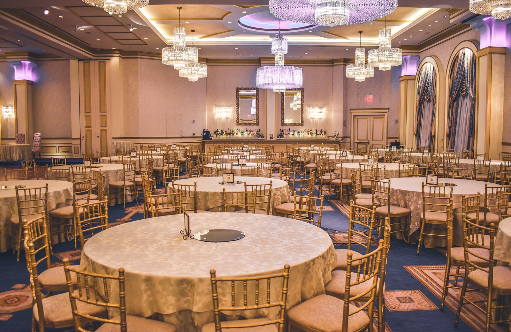

# Aura Events - Web Technologies (CSC336) Viva Preparation Guide
## Comprehensive CSS Architecture, Properties, Functions, Bootstrap 5 & Tailwind CSS Master Guide

**Course:** Web Technologies (CSC336) — Semester 4 (BSAI)  
**Instructor:** Sir Asif Shahzad  
**Project:** AURA Events — Luxury Event Management & Interactive Planning Platform  
**Document Purpose:** Complete CSS reference, properties, functions, frameworks (Bootstrap 5.3 & Tailwind CSS), and viva defense questions.

---

## 1. Project CSS Architecture & Syllabus Mapping

The CSS in Aura Events is engineered according to the **CSC336 Web Technologies Course Syllabus**, strictly adhering to progressive enhancement, modularity, and responsive design standards.

### 1.1 Stylesheet Architecture

| Stylesheet File / Block | Purpose & Scope | Key Syllabus Concepts Demonstrated |
| :--- | :--- | :--- |
| `assets/css/style.css` (1,041 lines) | **Master Platform Stylesheet:** Core resets, typography scale, buttons, badges, navbar, card surfaces, global footer, and layout overrides. | Lectures 5 & 6 (Box Model, Resets), Lecture 7 (Positioning), Lecture 8 (Flexbox, CSS3 Effects), Lecture 9 (Media Queries). |
| `assets/css/configurator.css` (628 lines) | **Interactive Configurator & Dashboard Stylesheet:** Multi-step wizard progress bar, sticky price calculator, selectable cards, and status timeline. | Lecture 7 (`position: sticky`), Lecture 8 (Flex layouts, CSS transitions), Lecture 9 (Responsive mobile overrides). |
| `assets/css/staff.css` (707 lines) | **Staff Operations Management Stylesheet:** CSS Grid-based operational dashboards, request cards, status conflict pills, modal panels, and metric decks. | Lecture 8 (CSS Grid, flexbox), Lecture 6 (Box Model, status borders), Lecture 9 (Media queries). |
| Internal `<style>` Tags (4 Templates) | **Page-Specific Scoped Styles:** Found in `index.html`, `login.html`, `register.html`, and `venue-detail.html`. | Custom linear-gradient hero overlays, split-screen authentication flex containers, and fixed-height photo carousels. |
| External Frameworks & CDNs | **Bootstrap 5.3.3 & Font Awesome 6.5.2:** Loaded across all 10 templates. | 12-column flexbox grid system, ready-made responsive utility classes, and scalable vector typography. |

---

## 2. Master Catalog of ALL CSS Properties Used in Aura Events

Below are the **64+ CSS properties** deployed across `style.css`, `configurator.css`, and internal style blocks, categorized by their rendering role.

```
Total Properties Analyzed: 64 Core CSS Properties
Total Unique Rules / Selectors: Over 320 Declarations
```

---

### Category A: The Box Model & Dimensions (Lectures 5 & 6)

#### 1. `box-sizing: border-box;`
* **Values Used:** `border-box` (Global universal reset applied to `*, *::before, *::after`)
* **Role in Aura Events:** Eliminates layout-breaking width calculation bugs. When `padding` or `border` is added to any card, input, or grid column, it is absorbed *inside* the defined width rather than expanding the element outward.
* **Viva High-Yield Formula:**
  $$\text{Rendered Width} = \text{Specified Width (Padding and Border included)}$$

#### 2. `width` & `max-width`
* **Values Used:** `100%`, `auto`, `20px`, `44px`, `56px`, `105px`, `440px`, `580px`, `650px`, `900px`
* **Role in Aura Events:** Controls element breadths. `max-width: 900px; margin: 0 auto;` is used on section headers and hero banners to constrain reading line lengths to comfortable ergonomic spans.

#### 3. `min-width` & `min-height`
* **Values Used:** `min-width: 240px;`, `min-width: 320px;`, `min-height: 100vh;`
* **Role in Aura Events:** `min-height: 100vh;` is used in `login.html` and `register.html` on `.auth-split-wrapper` to ensure the split-screen authentication container spans the full vertical viewport height on all screen sizes.

#### 4. `height`
* **Values Used:** `100%`, `auto`, `44px`, `56px`, `120px`, `180px`, `220px`, `440px`
* **Role in Aura Events:** Establishes fixed boundaries for media viewports, e.g., `.venue-hero-gallery-img { height: 440px; }` in `venue-detail.html` ensures all carousel images maintain uniform height regardless of source aspect ratios.

#### 5. `padding`, `padding-top`, `padding-bottom`, `padding-left`, `padding-right`
* **Values Used:** `0`, `0.5rem`, `0.75rem 1.25rem`, `10px 20px`, `14px`, `36px 16px`, `48px`
* **Role in Aura Events:** Generates internal breathing room inside buttons, input fields, cards, and modal dialogs.

#### 6. `margin`, `margin-top`, `margin-bottom`, `margin-left`, `margin-right`
* **Values Used:** `0`, `0 auto`, `-3px`, `-7px`, `0.25rem`, `0.5rem`, `1rem`, `1.5rem`, `3rem`
* **Role in Aura Events:** Controls external spacing between adjacent components. Negative margins (`margin-top: -7px;`) are used for fine-tuned icon alignment, while `margin: 0 auto;` centers block containers.

---

### Category B: Layout, Flexbox & Display (Lectures 6 & 8)

#### 7. `display`
* **Values Used:** `none`, `block`, `inline`, `inline-block`, `flex`, `inline-flex`, `grid` (via Bootstrap)
* **Role in Aura Events:** Dictates rendering flow. `.navbar-toggler-aura { display: none !important; }` on desktop suppresses mobile buttons, while `display: flex;` powers interactive cards.

#### 8. `flex` & `flex-grow`
* **Values Used:** `flex: 1;`, `flex-grow: 1;`
* **Role in Aura Events:** Allows child elements (such as price tracker line items or form input groups) to expand dynamically to fill remaining available space within a flex row.

#### 9. `flex-direction`
* **Values Used:** `row`, `column`
* **Role in Aura Events:** Sets the main axis. Cards switch from `flex-direction: column;` on mobile to `flex-direction: row;` on desktop for wide horizontal layout.

#### 10. `flex-shrink`
* **Values Used:** `flex-shrink: 0;`
* **Role in Aura Events:** Prevents circular badge icons and step numbers in wizard headers from being squashed when container widths shrink.

#### 11. `justify-content`
* **Values Used:** `flex-start`, `center`, `flex-end`, `space-between`, `space-around`
* **Role in Aura Events:** Distributes child items along the main flex axis. Used in `.sticky-price-tracker` to push item labels to the far left and prices to the far right (`justify-content: space-between`).

#### 12. `align-items`
* **Values Used:** `flex-start`, `center`, `stretch`
* **Role in Aura Events:** Aligns items along the cross axis. Centers text vertically alongside icons in buttons (`align-items: center`).

#### 13. `gap`
* **Values Used:** `0.25rem`, `0.35rem`, `0.5rem`, `0.75rem`, `1rem`, `1.5rem`
* **Role in Aura Events:** Modern CSS property creating consistent gutter spacing between flex and grid children without resorting to messy margin hacks.

---

### Category C: Positioning & Stacking Context (Lecture 7)

#### 14. `position`
* **Values Used:** `static`, `relative`, `absolute`, `sticky`, `fixed`
* **Role in Aura Events:**
  * `relative`: Used on parent cards (`.aura-card`, `.selectable-card`) to establish a positioning coordinate anchor.
  * `absolute`: Used on decorative badges (`.badge-gold`, "Most Popular" tags) to position them over card corners (`top: 10px; right: 10px;`).
  * `sticky`: Powers the **Live Price Tracker Sidebar** (`position: sticky; top: 90px;`), keeping it visible as the user scrolls through the multi-step configurator.
  * `fixed`: Used for the mobile bottom floating price summary bar.

#### 15. `top`, `bottom`, `left`, `right`
* **Values Used:** `0`, `10px`, `90px`, `2rem`
* **Role in Aura Events:** Coordinates for positioned elements.

#### 16. `z-index`
* **Values Used:** `1`, `2`, `10`, `1030`
* **Role in Aura Events:** Manages stacking order along the 3D Z-axis. `z-index: 1030;` ensures the fixed navigation bar and sticky price tracker float above regular card surfaces and background images.

---

### Category D: Typography & Text Styling (Lecture 5)

#### 17. `font-family`
* **Values Used:** `'DM Sans', sans-serif;`, `'Plus Jakarta Sans', sans-serif;`, `'Inter', sans-serif;`
* **Role in Aura Events:** *Plus Jakarta Sans* is used for high-contrast luxury headings, and *DM Sans* is used for clean, accessible body text.

#### 18. `font-size`
* **Values Used:** `0.65rem`, `0.72rem`, `0.75rem`, `0.85rem`, `1rem`, `1.02rem`, `1.25rem`, `1.5rem`, `2rem`
* **Role in Aura Events:** Uses scalable `rem` (Root EM) units relative to the browser root font size (16px), ensuring accessibility when users adjust browser zoom.

#### 19. `font-weight`
* **Values Used:** `400` (Regular), `500` (Medium), `600` (Semi-bold), `700` (Bold), `800` (Extra-bold)
* **Role in Aura Events:** Establishes typographic hierarchy.

#### 20. `line-height`
* **Values Used:** `1.1`, `1.15`, `1.4`, `1.6`, `1.8`
* **Role in Aura Events:** Unitless multipliers ensuring optimal vertical leading for dense headings (`1.15`) and comfortable reading paragraphs (`1.6`-`1.8`).

#### 21. `letter-spacing`
* **Values Used:** `-0.015em`, `-0.01em`, `0.05em`, `0.08em`
* **Role in Aura Events:** Positive tracking (`0.08em`) gives uppercase subheaders a luxury editorial feel, while negative tracking (`-0.015em`) tightens large display headings.

#### 22. `text-align`, `text-decoration`, `text-transform`, `white-space`, `vertical-align`
* **Values Used:** `center`, `end`, `none`, `uppercase`, `nowrap`, `middle`
* **Role in Aura Events:** `text-transform: uppercase;` styles metadata badges; `white-space: nowrap;` prevents prices from awkwardly breaking across multiple lines.

---

### Category E: Backgrounds, Gradients & Colors (Lecture 5 & 8)

#### 23. `color` & `background-color`
* **Values Used:** Hex (`#141413`, `#FFFFFF`, `#D9381E`, `#B45309`, `#1B4332`), RGB/RGBA, and CSS variables.
* **Role in Aura Events:** Applies brand colors: Deep Navy (`#0B132B`), Champagne Crimson/Gold (`#D9381E`), Warm Off-white (`#F7F6F2`).

#### 24. `background-image`, `background-position`, `background-repeat`, `background-size`
* **Values Used:** `cover`, `center`, `no-repeat`, `url('../images/royal-palm.jpg')`
* **Role in Aura Events:** Crafts immersive hero backdrops on the home, login, and registration pages.

---

### Category F: Borders, Radii & Shadows (Lectures 5 & 8)

#### 25. `border`, `border-color`, `border-top`, `border-bottom`, `border-left`, `border-right`
* **Values Used:** `1px solid #E5E3DC`, `1px dashed #E5E3DC`, `3px solid #D9381E`
* **Role in Aura Events:** Delicately delineates cards. Active selected cards receive an accentuated `3px solid #D9381E` border.

#### 26. `border-radius`
* **Values Used:** `2px`, `4px`, `6px`, `12px`, `50%` (circular avatars)
* **Role in Aura Events:** Delivers a modern, refined curved aesthetic across cards, pill badges, and buttons.

#### 27. `box-shadow`
* **Values Used:**
  * Subdued Card Shadow: `0 1px 3px rgba(20, 20, 19, 0.06), 0 1px 2px rgba(20, 20, 19, 0.04);`
  * Floating Modal / Hero Shadow: `0 20px 50px rgba(0, 0, 0, 0.3);`
  * Focus Glow Ring: `0 0 0 1px #D9381E;`

---

### Category G: Modern CSS3 Effects, Transforms & Transitions (Lecture 8)

#### 28. `transform`
* **Values Used:** `scale(1.08)`, `translateY(-3px)`, `none`
* **Role in Aura Events:** Creates smooth micro-interactions. Hovering over a venue card lifts it vertically by 3px (`translateY(-3px)`), conveying tactile responsiveness.

#### 29. `transition`
* **Values Used:** `background-color 0.15s ease, border-color 0.15s ease, color 0.15s ease, transform 0.2s ease`
* **Role in Aura Events:** Smooths out color and transform changes on hover, avoiding abrupt jarring flickers.

#### 30. `backdrop-filter`
* **Values Used:** `blur(12px)`, `blur(16px)`
* **Role in Aura Events:** Generates high-end **glassmorphism** on sticky headers and floating price summary overlays.

#### 31. `object-fit`
* **Values Used:** `cover`
* **Role in Aura Events:** Prevents image distortion. Ensures venue photos fill their rectangular card boundaries without stretching or altering their aspect ratios.

#### 32. `opacity`, `visibility`, `pointer-events`, `cursor`
* **Values Used:** `opacity: 0.75;`, `visibility: hidden;`, `pointer-events: none;`, `cursor: pointer;`, `cursor: not-allowed;`
* **Role in Aura Events:** Manages interactivity states (e.g., setting `cursor: not-allowed;` and `opacity: 0.5;` for booked-out venue slots).

---

### Category H: Generated Content & Overflow (Lectures 6 & 8)

#### 33. `content`
* **Values Used:** `content: "";`, `content: "✓";`, `content: "Exceeds Capacity";`
* **Role in Aura Events:** Injected via `::before` and `::after` pseudo-elements to render custom checkbox checkmarks and capacity warnings.

#### 34. `overflow` & `overflow-x`
* **Values Used:** `overflow: hidden;`, `overflow-x: hidden;`
* **Role in Aura Events:** Prevents unwanted horizontal scrollbars on mobile viewports.

---

## 3. Master Inventory of CSS Functions Used in Aura Events

The Aura Events codebase utilizes **7 distinct CSS functions**:

```
CSS Functions Detected:
1. var()              5. scale()
2. rgba()             6. translateY()
3. linear-gradient()  7. blur()
4. url()              8. repeat()
```

### 1. `var(--custom-property-name [, fallback])`
* **What it does:** Reads the value of a CSS Custom Property (variable) declared in `:root` or an ancestor scope.
* **Code Example (`style.css#L115`):**
  ```css
  background-color: var(--aura-gold);
  border-radius: var(--aura-radius-md);
  ```

### 2. `rgba(red, green, blue, alpha)`
* **What it does:** Generates colors with an adjustable opacity/alpha channel ($0.0 = \text{completely transparent}, 1.0 = \text{completely opaque}$).
* **Code Example (`style.css#L540`):**
  ```css
  box-shadow: 0 1px 3px rgba(20, 20, 19, 0.06), 0 1px 2px rgba(20, 20, 19, 0.04);
  ```

### 3. `linear-gradient(direction, color-stop-1, color-stop-2, ...)`
* **What it does:** Renders a progressive 2D color transition across a background surface.
* **Code Example (`index.html#L21`):**
  ```css
  background: linear-gradient(180deg, rgba(11, 19, 43, 0.78) 0%, rgba(11, 19, 43, 0.92) 100%),
              url('assets/images/royal-palm.jpg') center/cover no-repeat;
  ```
  *(Creates a dark luxury overlay that guarantees high contrast for overlaid white text).*

### 4. `url('path/to/resource')`
* **What it does:** References external fonts or image assets to be loaded by the browser.
* **Code Example (`style.css#L10`):**
  ```css
  @import url('https://fonts.googleapis.com/css2?family=DM+Sans:wght@400;500;600&display=swap');
  ```

### 5. `scale(factor)`
* **What it does:** Multiplies an element's dimensional size along the X and Y axes without displacing surrounding layout elements.
* **Code Example (`configurator.css#L240`):**
  ```css
  .selectable-card:hover .card-img-top {
    transform: scale(1.08);
  }
  ```

### 6. `translateY(offset)`
* **What it does:** Shifts an element vertically up (negative value) or down (positive value) using GPU hardware acceleration.
* **Code Example (`style.css#L145`):**
  ```css
  .btn-aura-gold:hover {
    transform: translateY(-3px);
  }
  ```

### 7. `blur(radius)`
* **What it does:** Applies a Gaussian blur filter algorithm. Used in combination with `backdrop-filter` for glassmorphism.
* **Code Example (`configurator.css#L605`):**
  ```css
  .mobile-price-bar {
    backdrop-filter: blur(12px);
    background-color: rgba(255, 255, 255, 0.85);
  }
  ```

---

## 4. CSS Variables, Pseudo-Selectors & Media Queries

### 4.1 CSS Custom Properties (Variables) Declared in `:root`

```css
:root {
  --aura-gold: #D9381E;         /* Primary brand accent */
  --aura-danger: #D9381E;       /* Warning / destructive actions */
  --aura-warning: #B45309;      /* Pending status badge */
  --aura-success: #1B4332;      /* Confirmed booking green */
  --aura-info: #1B4332;         /* Informational chips */
  --aura-radius-lg: 6px;        /* Large card corner radius */
  --aura-radius-md: 4px;        /* Button corner radius */
  --aura-radius-sm: 4px;        /* Badge corner radius */
}
```

### 4.2 Pseudo-Classes & Pseudo-Elements Deployed

* `:root`: Targets the document's highest-level DOM node to define global design tokens.
* `:hover`: Activates visual feedback when a pointer hovers over buttons and cards.
* `:focus`: Enhances keyboard accessibility by rendering high-visibility outline rings.
* `:active`: Provides visual feedback during the physical click/tap down-stroke.
* `:checked`: Selectively styles customized radio buttons and checkboxes when activated.
* `:last-child`: Strips bottom border dividers from the final item in booking summary lists.
* `::before` & `::after`: Injects non-DOM cosmetic elements (decorative sparkles, custom checkbox checkmarks).

### 4.3 Responsive Breakpoints & Media Queries Deployed

```css
/* Mobile Phones Breakpoint: Max-width 575.98px */
@media (max-width: 575.98px) {
  .page-hero-banner {
    padding: 36px 16px !important;
  }
  .mobile-price-bar {
    display: flex; /* Surfaces fixed price bar at bottom of mobile screen */
  }
}

/* Tablets & Mobile Landscape: Max-width 991.98px */
@media (max-width: 991.98px) {
  .sticky-price-tracker {
    position: static !important; /* Disables sticky positioning so sidebar flows naturally */
  }
}
```

---

## 5. Bootstrap 5.3 Framework Breakdown in Aura Events

Aura Events uses **Bootstrap 5.3.3** for its layout engine, grid scaffolding, and UI primitives.

### 5.1 The 12-Column Grid System

Bootstrap’s grid is composed of three tiers:
1. `.container`: Constrains page width and centers content with auto-margins.
2. `.row`: Flex wrapper with negative margins that groups and aligns columns.
3. `.col-{breakpoint}-{spans}`: Divides the horizontal 12-column track.

**Grid Classes Used in Aura Events Codebase:**
* Full-width mobile / half-width desktop: `.col-12 .col-md-6`
* Three-column card grid: `.col-12 .col-md-6 .col-lg-4`
* Four-column metric counters: `.col-6 .col-md-3`
* Configurator Split: Form controls (`.col-lg-8`) + Sticky Sidebar (`.col-lg-4`).

### 5.2 Project Bootstrap Class Inventory by Category

* **Backgrounds (12):** `bg-primary`, `bg-light`, `bg-dark`, `bg-white`, `bg-success`, `bg-warning`, `bg-danger`, `bg-secondary`, `bg-success-subtle`, `bg-gold-light`, `bg-opacity-10`, `bg-opacity-75`.
* **Flexbox Utilities (24):** `d-flex`, `d-none`, `d-block`, `d-md-flex`, `flex-column`, `flex-md-row`, `flex-grow-1`, `justify-content-between`, `justify-content-center`, `align-items-center`, `align-items-start`, `gap-2`, `gap-3`.
* **Spacing (48):**
  * Margins: `m-2`, `mb-0`, `mb-1`, `mb-2`, `mb-3`, `mb-4`, `mb-5`, `mt-auto`, `mx-auto`, `mb-lg-0`.
  * Paddings: `p-0`, `p-2`, `p-3`, `p-4`, `px-4`, `px-5`, `py-2`, `py-3`, `py-4`, `py-5`.
* **Typography (32):** `display-4`, `display-5`, `display-6`, `fs-3`, `fs-4`, `fs-5`, `fs-6`, `fs-7`, `fw-bold`, `fw-semibold`, `text-center`, `text-end`, `text-white`, `text-muted`, `text-dark`, `text-primary`, `text-danger`, `text-uppercase`, `text-decoration-none`.
* **Borders & Radii (17):** `border`, `border-0`, `border-3`, `border-top`, `border-bottom`, `border-secondary-subtle`, `rounded`, `rounded-2`, `rounded-3`, `rounded-circle`.
* **Components (Buttons, Cards, Badges, Forms, Navbars):**
  * `btn`, `btn-sm`, `btn-lg`, `btn-outline-primary`, `btn-outline-light`, `btn-outline-danger`.
  * `card`, `card-body`, `card-img-top`.
  * `badge`, `badge-gold`.
  * `form-control`, `form-select`, `form-check`, `form-check-input`, `form-check-label`.
  * `navbar`, `navbar-expand-lg`, `navbar-nav`, `nav-item`, `nav-link`, `breadcrumb`, `breadcrumb-item`.
  * `carousel`, `carousel-item`, `carousel-control-prev`, `carousel-control-next`, `carousel-indicators`.
  * `table`, `table-bordered`, `table-light`, `table-warning`.

---

## 6. Tailwind CSS Architecture, Properties & Viva Comparison

Although Bootstrap 5 is the linked framework, **Tailwind CSS** is an essential syllabus comparison topic in Web Technologies vivas.

### 6.1 What is Tailwind CSS?
**Tailwind CSS** is a **utility-first CSS framework**. Unlike Bootstrap, which provides opinionated, pre-built components (like `.card`, `.btn`, `.navbar`), Tailwind provides low-level atomic utility classes (like `flex`, `pt-4`, `text-center`, `rotate-90`) that let developers compose custom UI designs directly inside their HTML without writing a single line of custom CSS.

### 6.2 Key Architecture Concepts of Tailwind CSS

1. **Utility-First Paradigm:** Small, single-purpose classes composed directly in HTML.
2. **JIT (Just-In-Time) Engine:** Compiles only the CSS classes that are actually used in template files, yielding tiny production CSS files (often under 15KB).
3. **Arbitrary Values:** Support for ad-hoc values via brackets: `top-[90px]`, `bg-[#0B132B]`, `grid-cols-[200px_1fr]`.
4. **Responsive Prefixes:** Mobile-first variants (`sm:`, `md:`, `lg:`, `xl:`, `2xl:`).
5. **State Variants:** Pseudo-class modifiers: `hover:bg-red-700`, `focus:ring-2`, `disabled:opacity-50`.
6. **The `@apply` Directive:** Extracts repeated utility chains into clean custom CSS classes.

---

### 6.3 Side-by-Side Comparison: Aura Custom CSS vs Bootstrap 5 vs Tailwind CSS

| Styling Purpose | Aura Events Custom CSS | Bootstrap 5.3 Utility | Tailwind CSS Equivalent |
| :--- | :--- | :--- | :--- |
| **Flex Container & Centering** | `display: flex; align-items: center; justify-content: center;` | `.d-flex .align-items-center .justify-content-center` | `flex items-center justify-center` |
| **Grid 3-Column Layout** | `display: grid; grid-template-columns: repeat(3, 1fr); gap: 1rem;` | `.row` + 3x `.col-lg-4` | `grid grid-cols-1 md:grid-cols-3 gap-4` |
| **Sticky Sidebar** | `position: sticky; top: 90px;` | `.sticky-top` *(requires custom top offset)* | `sticky top-[90px]` |
| **Rounded Card with Shadow**| `border-radius: 6px; box-shadow: 0 1px 3px rgba(0,0,0,0.1);` | `.card .rounded-2 .shadow-sm` | `bg-white rounded-md shadow-sm border border-slate-200` |
| **Hover Lift Micro-interaction**| `transform: translateY(-3px); transition: 0.2s;` | Custom CSS required (`.aura-card:hover`) | `transition-transform duration-200 hover:-translate-y-1` |
| **Backdrop Glassmorphism** | `backdrop-filter: blur(12px);` | Custom CSS required | `backdrop-blur-md bg-white/80` |
| **Primary Brand Button** | `.btn-aura-gold { background: #D9381E; }` | `.btn .btn-danger` | `px-5 py-2.5 bg-[#D9381E] text-white font-medium rounded hover:bg-[#b82e18] transition-colors` |
| **Typography Display Header**| `font-size: 2rem; font-weight: 700;` | `.display-5 .fw-bold` | `text-4xl font-bold tracking-tight text-slate-900` |

---

### 6.4 Component Code Translation: Aura Event Card

#### In Bootstrap 5 + Custom CSS (Current Project Implementation):
```html
<div class="card aura-card shadow-sm border-0 position-relative">
  
  <span class="badge badge-gold position-absolute top-0 end-0 m-3">Featured</span>
  <div class="card-body p-4">
    <h5 class="fw-bold mb-1">The Royal Palm Grand Ballroom</h5>
    <p class="text-muted small mb-3">Canal Bank Road, Lahore</p>
    <div class="d-flex justify-content-between align-items-center">
      <span class="fw-bold text-primary">PKR 250,000</span>
      <a href="book-event.html" class="btn btn-aura-gold btn-sm">Book Venue</a>
    </div>
  </div>
</div>
```

#### The Exact Same Card in Tailwind CSS:
```html
<div class="relative bg-white rounded-lg shadow-sm border border-slate-200 overflow-hidden group hover:shadow-md transition-shadow">
  
  <span class="absolute top-3 right-3 bg-[#D9381E] text-white text-xs font-semibold px-2.5 py-1 rounded">Featured</span>
  <div class="p-4">
    <h3 class="text-lg font-bold text-slate-900 mb-0.5">The Royal Palm Grand Ballroom</h3>
    <p class="text-xs text-slate-500 mb-3">Canal Bank Road, Lahore</p>
    <div class="flex items-center justify-between">
      <span class="font-bold text-[#D9381E] text-base">PKR 250,000</span>
      <a href="book-event.html" class="px-3.5 py-1.5 bg-[#D9381E] hover:bg-[#b82e18] text-white text-sm font-medium rounded transition-colors">Book Venue</a>
    </div>
  </div>
</div>
```

---

## 7. Top 30 Viva Examiner Questions & High-Scoring Model Answers

### Q1: What is the CSS Box Model, and how does `box-sizing: border-box` change it?
**Model Answer:**  
"The CSS Box Model is the structural foundation of web page layout. Every HTML element forms a rectangular box composed of four concentric layers:
1. **Content:** The text, image, or child elements.
2. **Padding:** Transparent space between content and the border.
3. **Border:** The decorative line wrapping the padding.
4. **Margin:** Transparent space separating the element from adjacent sibling elements.

Under the default `box-sizing: content-box`, if you set an element to `width: 300px;` and add `padding: 20px;` with a `border: 2px;`, the browser expands the rendered width to $300 + 40 + 4 = 344\text{px}$, which frequently breaks grid layouts.  
By declaring `box-sizing: border-box` globally, padding and borders are absorbed *inside* the defined width. The rendered width remains exactly $300\text{px}$, which prevents unexpected layout wrapping."

### Q2: Explain the four values of the `position` property: `static`, `relative`, `absolute`, and `sticky`.
**Model Answer:**  
* `static`: The default position. Elements render strictly according to natural document flow. Top, bottom, left, right, and z-index have **zero effect**.
* `relative`: Positioned relative to where it would naturally sit in document flow. Shifting it via `top` or `left` does not alter the space reserved for it. Most importantly, it creates a **positioning coordinate context** for absolute child elements.
* `absolute`: Removed entirely from natural document flow. It occupies zero space in normal document flow and positions itself relative to its closest non-static ancestor.
* `sticky`: A hybrid. It acts as `position: relative` until the user scrolls past a designated threshold (e.g. `top: 90px;`), at which point it pins itself in place like `position: fixed` within the boundaries of its parent container. *(Used for our Live Price Tracker in `book-event.html`)*."

### Q3: When should you use Flexbox vs. CSS Grid?
**Model Answer:**  
"The fundamental distinction is **dimensionality**:
* **Flexbox is 1-Dimensional:** It arranges elements along a single axis at a time — either as a horizontal row or a vertical column. It is ideal for UI components such as navbars, button groups, breadcrumbs, and aligned form inputs.
* **CSS Grid is 2-Dimensional:** It controls both rows and columns simultaneously. It is ideal for macro-layouts, complex photo galleries, and multi-track dashboards where horizontal and vertical alignment must align together.
In Aura Events, we use Bootstrap's flex-based grid for general component responsiveness, and Flexbox for internal card item distribution."

### Q4: How is CSS Specificity calculated? Why did your project use `!important` in some places?
**Model Answer:**  
"CSS Specificity determines which CSS rule takes precedence when multiple rules target the same DOM element. It is calculated as a 4-part vector $(a, b, c, d)$:
1. **$a$ (Inline Styles):** Directly declared in HTML `style="..."` attribute (Weight: 1000).
2. **$b$ (IDs):** Selectors targeting `#elementId` (Weight: 100).
3. **$c$ (Classes, Attributes & Pseudo-classes):** `.className`, `[type="text"]`, `:hover` (Weight: 10).
4. **$d$ (Elements & Pseudo-elements):** `div`, `p`, `h1`, `::before` (Weight: 1).

In `style.css` and `configurator.css`, `!important` was applied in a few specific rules to intentionally override Bootstrap's aggressive default styles (such as removing border-radius from form controls or forcing custom padding on hero banners) without needing unnecessarily long selector chains."

### Q5: What are CSS Custom Properties (Variables), and what advantages do they have over SASS/LESS variables?
**Model Answer:**  
"CSS Custom Properties are native variables declared with two dashes (e.g., `--aura-gold: #D9381E;`) and read via `var()`.  
They hold three major advantages over preprocessor variables (SASS/LESS):
1. **Dynamic & Runtime-Accessible:** They live directly inside the browser DOM and can be inspected or modified at runtime via JavaScript (`element.style.setProperty()`).
2. **Inheritance & Scoping:** They follow the cascade and can be overridden inside specific subtrees (e.g., changing theme variables inside a `.dark-theme` class).
3. **No Compilation Step:** They run natively in all modern browsers without needing build tools like Webpack or Vite."

### Q6: What is a Stacking Context and what role does `z-index` play?
**Model Answer:**  
"`z-index` controls the rendering order along the perpendicular Z-axis (depth). However, `z-index` only works on elements that have a specified `position` other than `static` (or are direct flex/grid children).  
A **stacking context** is a 3D layering environment created by certain CSS properties (such as `position: relative` with a `z-index`, `opacity < 1`, or `transform`). Child elements cannot stack above external elements if their parent stacking context is lower than that of the external element."

### Q7: What are Pseudo-classes vs. Pseudo-elements?
**Model Answer:**  
* **Pseudo-classes (single colon `:`):** Target an element based on its dynamic state or DOM tree position. Examples: `:hover` (cursor interaction), `:focus` (keyboard activation), `:checked` (form state), `:last-child` (DOM structural position).
* **Pseudo-elements (double colon `::`):** Target or create an abstract sub-part of an element. Examples: `::before` and `::after` (which inject decorative text or icons via the `content` property without adding extra HTML nodes)."

### Q8: What is the difference between `display: none;` and `visibility: hidden;`?
**Model Answer:**  
* `display: none;`: Completely removes the element from the document layout flow. It occupies zero width, zero height, and siblings collapse into its space.
* `visibility: hidden;`: Hides the element visually, but the element still retains its layout space, width, and height in the document flow. Siblings do not move."

### Q9: What are Responsive Breakpoints, and why is "Mobile-First" preferred?
**Model Answer:**  
"A breakpoint is a viewport width defined in a media query where the layout reorganizes to match screen dimensions. Bootstrap uses:
* `sm` (576px), `md` (768px), `lg` (992px), `xl` (1200px), `xxl` (1400px).

**Mobile-First Design** means writing baseline CSS for mobile devices using `min-width` media queries to progressively enhance the design for larger screens. It is preferred because:
1. It encourages prioritizing essential content first.
2. Mobile devices process minimal styles first without overriding complex desktop rules, boosting mobile rendering performance."

### Q10: How does Bootstrap's Grid work under the hood?
**Model Answer:**  
"Bootstrap 5's grid is built entirely with CSS Flexbox:
1. `.container`: Provides padding gutters (`12px` or `15px` on left and right) and centers content.
2. `.row`: Uses `display: flex; flex-wrap: wrap;` with negative left and right margins to offset the container's padding.
3. `.col-*`: Calculates fractional widths using flex percentages:
   $$\text{Width} = \left(\frac{\text{Column Span}}{12}\right) \times 100\%$$
   For example, `.col-md-6` applies `width: 50%;` above 768px."

### Q11: What is Tailwind CSS, and how does its philosophy differ from Bootstrap?
**Model Answer:**  
"Bootstrap is a **Component-First** framework that provides pre-styled, ready-to-use widgets (modals, navbars, cards). It speeds up initial development but often results in cookie-cutter websites that require extensive CSS overrides to customize.  
Tailwind CSS is an **Atomic / Utility-First** framework that provides single-purpose helper classes. You assemble bespoke interfaces directly in HTML without leaving your markup, resulting in completely custom UI designs with zero CSS bloat thanks to its PurgeCSS / JIT compiler."

### Q12: What is the Tailwind JIT (Just-In-Time) compiler?
**Model Answer:**  
"In older versions of Tailwind, the compiler generated thousands of pre-calculated utility classes, resulting in multi-megabyte development stylesheets. The **JIT engine** scans your HTML/JS files in real time, detects the exact class names you typed, and generates *only* the CSS rules needed on the fly. It supports arbitrary values (e.g. `w-[347px]`, `bg-[#D9381E]`) and produces production stylesheets that are often under 15KB."

### Q13: What does the Tailwind `@apply` directive do?
**Model Answer:**  
"The `@apply` directive allows developers to extract repetitive utility class strings into reusable custom CSS classes inside a stylesheet:
```css
.btn-primary {
  @apply px-4 py-2 bg-red-600 text-white font-semibold rounded hover:bg-red-700 transition;
}
```
This keeps HTML clean when components are repeated across multiple pages without component templating frameworks."

### Q14: How does `object-fit: cover` work on images?
**Model Answer:**  
"`object-fit: cover` instructs an `` or `<video>` element to resize itself to completely fill its container box while maintaining its original aspect ratio. Any overflow that exceeds the container boundaries is clipped rather than squashed or stretched. This is essential for venue cards where diverse photo uploads must render in uniform rectangular frames."

### Q15: What is the difference between `rem` and `em` font sizing units?
**Model Answer:**  
* `rem` (Root EM): Relative exclusively to the `font-size` of the root `<html>` element (default is 16px, so $1\text{rem} = 16\text{px}$, $1.5\text{rem} = 24\text{px}$). It prevents compounding cascade sizing bugs.
* `em`: Relative to the `font-size` of its **immediate parent element**. If nested inside multiple elements that define font sizes, `em` values compound exponentially ($1.2 \times 1.2 \times 1.2$).
In Aura Events, we use `rem` units across typography for predictable, accessible scaling."

---


### Q16: How does `grid-template-columns: repeat(auto-fit, minmax(220px, 1fr))` work without media queries in your staff portal?
**Model Answer:**  
"This is a modern responsive CSS Grid pattern used in `assets/css/staff.css`:
1. `repeat()`: Instructs the grid engine to repeat column tracks automatically.
2. `auto-fit`: Fills the row with as many column tracks as can physically fit, expanding existing tracks to fill vacant horizontal space.
3. `minmax(220px, 1fr)`: Sets the minimum width of any card to 220px and allows it to grow up to 1 fractional unit (`1fr`).
On a wide 1920px screen, it renders 4 to 6 columns; on a tablet, 2 columns; on a smartphone, 1 column — **completely fluidly without a single `@media` query**."

---

## 8. Quick Viva Trap-Avoidance Checklist for CSS & Frameworks

> [!CAUTION]
> **5 Critical Traps to Avoid During Your Viva Defense:**
> 1. **The Margin vs Padding Trap:** Stating that margins add space inside the border. *(Correction: Padding is INSIDE the border; margin is OUTSIDE the border).*
> 2. **The Inline Box Model Trap:** Trying to apply `height` or `margin-top` to an inline `<span>`. *(Correction: Inline elements do not respect vertical dimensions or vertical margins unless their display is set to `inline-block` or `block`).*
> 3. **The Tailwind Component Trap:** Saying Tailwind has ready-made `.card` or `.btn` classes like Bootstrap. *(Correction: Tailwind has no default component classes; you build cards using utility combinations like `bg-white p-6 rounded-lg shadow`).*
> 4. **The Sticky Positioning Trap:** Forgetting that `position: sticky` requires an offset like `top: 90px;` to function. Without a directional offset, sticky elements behave like `position: relative`.
> 5. **The Flexbox Alignment Trap:** Confusing `justify-content` with `align-items`. *(Correction: `justify-content` aligns along the MAIN axis; `align-items` aligns along the CROSS axis).*

